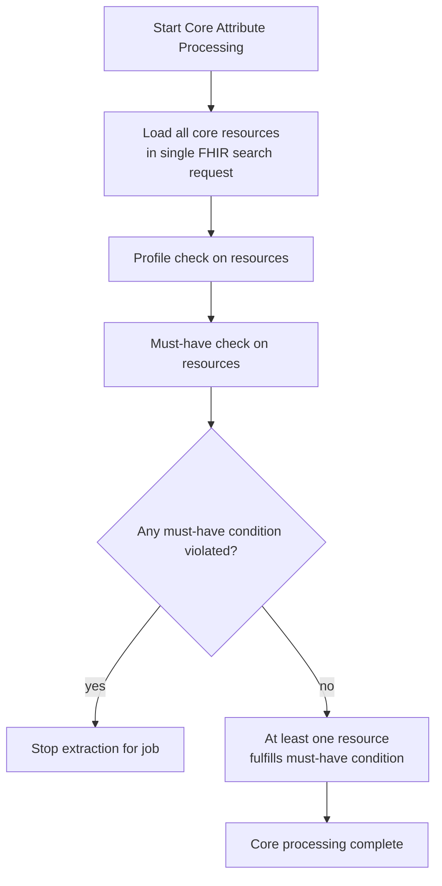
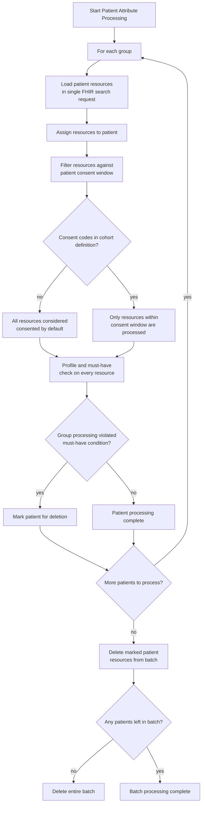

# Handling Attribute Groups Directly

TORCH distinguishes between directly loaded and referenced attributeGroups, where referenced attributeGroups are identified by the flag
`IncludeReferenceOnly`.
Directly loaded attributeGroups can be loaded directly as their inclusion in the extraction does not depend on any referencing.

TORCH loads all resources of the directly loaded attributeGroups based on the Fhir Profile specified in the attribute group and the filters applied to the attribute group.
I.e. resources are loaded based on the Fhir Profile specified in the attribute group and
the [filters](../crtdl/filter.md) applied to
the attribute group.

The processing has two separate workflows due to the different nature of the resources:

1. **Core Resources**: These are resources that are outside the patient compartment (no direct link to Patient - e.g. Medication).
2. **Patient Resources**: These are resources that are directly loaded and processed for each patient.

## 1. Directly Loaded Core Attribute Groups

Core attributes are simply loaded and processed in a single step.

This means that all resources that are part of the core attribute group are loaded and processed in a single fhir search
request.

- After that a profile and must-have check is done on the resources.
    - Must-have conditions are violated if **not a single** resource passes this check.
- If any **must-have** condition is violated, the extraction is fully stopped for the job.
- At the same time it is sufficient if the must-have conditions are fulfilled for a single "global" resource.

## 2. Directly Loaded Patient Attribute Groups

Patient attribute groups are loaded and processed for each patient.

All resources from a patient attribute group are loaded and processed in a single fhir search request
and then assigned to their patient.

- Each loaded resource is filtered against the patient's consent window; only resources within the consent period are processed further.
    - When no consent codes are present in the cohort definition, all resources are considered consented by default.
- A profile and must-have check is done on every resource.

- If after the group processing a must-have condition is violated, the respective patient is marked for deletion. Once all patients are processed,
  all resources (including the patient resource itself) for a patient marked for deletion are deleted. If no resources are left the whole batch is deleted.

## 3. Assigning Resources to Patients

For each resource type of the Patient compartment, TORCH uses **one** search parameter, taken from the
[Patient CompartmentDefinition](https://hl7.org/fhir/R4/compartmentdefinition-patient.html) and the R4 SearchParameter
definitions. The same parameter is used for three things:

* searching the resources of a batch's patients,
* deciding which patient a loaded resource belongs to (this patient's consent is checked),
* the standard attributes that are always extracted.

The standard attribute is linked to the patient group. If the CRTDL declares the same element with `linkedGroups`, these
groups are linked too. Then references to other resource types in that element, e.g. a `Practitioner` in
`Appointment.participant.actor`, are resolved as well. Otherwise they are replaced by a data-absent-reason.

This matters most for types whose patient element routinely references other resource types:

| Resource type       | Element that decides the patient       |
|---------------------|----------------------------------------|
| Appointment         | `participant.actor`                    |
| AppointmentResponse | `actor`                                |
| AuditEvent          | `agent.who`, `entity.what`             |
| Group               | `member.entity`                        |
| Person              | `link.target`                          |
| Provenance          | `target`                               |
| Schedule            | `actor`                                |
| SupplyRequest       | `deliverTo`                            |

Only the `Patient` references in these elements decide the patient; references to other types are ignored for that.

The parameter is `_id` for `Patient`. For other types it is `patient` where the type defines it, otherwise the first
parameter of the compartment definition that can reference a `Patient`. Only these types don't use `patient`:

| Resource type | Search parameter | Element that decides the patient |
|---------------|------------------|----------------------------------|
| AdverseEvent  | `subject`        | `AdverseEvent.subject`           |
| Group         | `member`         | `Group.member.entity`            |
| Schedule      | `actor`          | `Schedule.actor`                 |
| SupplyRequest | `subject`        | `SupplyRequest.deliverTo`        |

Only relative references of the form `Patient/<id>` count, optionally versioned (`Patient/<id>/_history/<v>`). A
reference without a value, e.g. one carrying only a data-absent-reason, counts as no patient.

A loaded resource is handled as follows:

* **One patient:** the resource is assigned to that patient.
* **No patient:** the resource is excluded as `PATIENT_NOT_FOUND`.
* **Several distinct patients:** the resource is not assigned to any of them and is excluded as `MULTIPLE_PATIENTS`.
  A resource loaded through a reference is only kept if every patient it references is the patient of the bundle.

### Limitation: other patient references are ignored

Only the element behind the chosen search parameter decides the patient. Other elements that may also reference a
`Patient` are **not** used to assign the resource, to check consent or to detect several patients. For example, a
child's `Coverage` with a parent as `subscriber` belongs to the child only.

This doesn't put another patient's data in the extraction. A reference in such an element is kept only if it is
resolved as a linked group, and a referenced `Patient` other than the bundle's patient is rejected when it is loaded.
Any reference that isn't resolved is replaced by a data-absent-reason during redaction, so the other patient's ID isn't
exported either.

The following elements of the compartment definition may reference a `Patient` but are ignored. Elements that aren't
part of the compartment definition, such as extensions, are never considered.

| Resource type            | Element that decides the patient | Ignored elements that may reference a Patient                                    |
|--------------------------|----------------------------------|----------------------------------------------------------------------------------|
| AllergyIntolerance       | `patient`                        | `recorder`, `asserter`                                                           |
| Basic                    | `subject`                        | `author`                                                                         |
| CarePlan                 | `subject`                        | `activity.detail.performer`                                                      |
| CareTeam                 | `subject`                        | `participant.member`                                                             |
| Claim                    | `patient`                        | `payee.party`                                                                    |
| Communication            | `subject`                        | `sender`, `recipient`                                                            |
| CommunicationRequest     | `subject`                        | `sender`, `recipient`, `requester`                                               |
| Composition              | `subject`                        | `author`, `attester.party`                                                       |
| Condition                | `subject`                        | `asserter`                                                                       |
| Coverage                 | `beneficiary`                    | `policyHolder`, `subscriber`, `payor`                                            |
| DeviceRequest            | `subject`                        | `performer`                                                                      |
| DocumentManifest         | `subject`                        | `author`, `recipient`                                                            |
| DocumentReference        | `subject`                        | `author`                                                                         |
| ExplanationOfBenefit     | `patient`                        | `payee.party`                                                                    |
| Invoice                  | `subject`                        | `recipient`                                                                      |
| List                     | `subject`                        | `source`                                                                         |
| MedicationAdministration | `subject`                        | `performer.actor`                                                                |
| MedicationDispense       | `subject`                        | `receiver`                                                                       |
| Observation              | `subject`                        | `performer`                                                                      |
| Procedure                | `subject`                        | `performer.actor`                                                                |
| QuestionnaireResponse    | `subject`                        | `author`                                                                         |
| RequestGroup             | `subject`                        | `action.participant`                                                             |
| ServiceRequest           | `subject`                        | `performer`                                                                      |

How to extract resources that belong to several patients is tracked in
[#1382](https://github.com/medizininformatik-initiative/torch/issues/1382).
