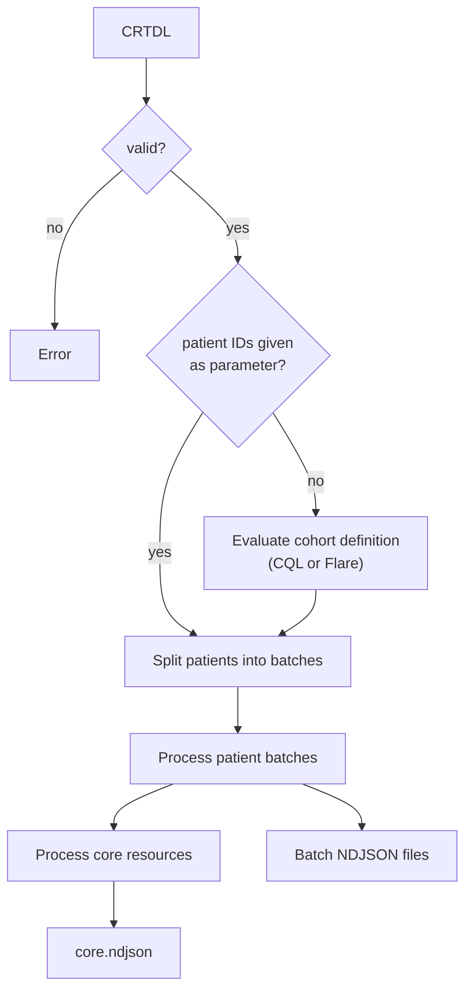
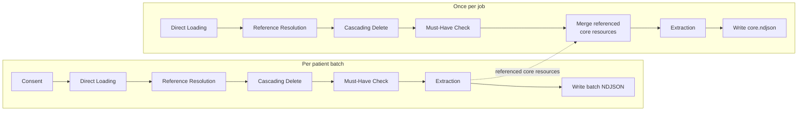

# Implementation Overview

TORCH extracts FHIR resources for a cohort as defined by a [CRTDL](../crtdl/crtdl.md).
An extraction runs as an asynchronous job: the CRTDL is validated when the job is submitted, and the job is then
processed in three phases.

1. **Cohort** — determine the patients to extract.
2. **Patient batches** — extract the patient-related data, one batch of patients at a time.
3. **Core** — extract the core resources once for the whole job.

## Patient Resources and Core Resources

TORCH splits all resources into two kinds, based on the
FHIR [Patient Compartment](https://hl7.org/fhir/R4/compartmentdefinition-patient.html):

- **Patient resources** are resources **within** the patient compartment, e.g. `Patient`, `Condition`,
  `Observation` or `Encounter`. Each of them belongs to exactly one patient and is processed in that patient's batch.
- **Core resources** are resources **outside** the patient compartment, e.g. `Medication`, `Organization` or
  `Practitioner`. They do not belong to a single patient, can be referenced by many patients, and are processed once
  per job in the core phase.

Whether a resource is a patient or a core resource depends only on its resource type, not on its content or profile.
Attribute groups are split the same way: an attribute group whose resource type is in the patient compartment is a
patient attribute group; all others are core attribute groups.

## Job Submission

The CRTDL is [validated](validation.md) before the job is created. An invalid CRTDL is rejected immediately and no job
is started. During validation, the attribute groups are annotated with the StructureDefinition information needed later
on, so that this work is done only once per job.

## Cohort

If patient IDs are passed as a parameter, they are used as the cohort.
Otherwise, the cohort definition of the CRTDL is evaluated, either with CQL on the FHIR server or with Flare.
The resulting patients are split into batches (see [`TORCH_BATCHSIZE`](../configuration.md#torch-batchsize)).

## Patient Batches

Each batch is processed independently; up to [`TORCH_MAXCONCURRENCY`](../configuration.md#torch-maxconcurrency)
batches run in parallel:

1. **Consent** — Fetch the consent resources of the batch's patients and calculate their consent periods.
   Patients without a matching consent are excluded. If no patient in the batch has consented, the batch is skipped.
   This step is skipped if the CRTDL contains no consent criteria. See [Consent](consent.md).
2. **Direct Loading** — Load the resources of all directly loaded patient attribute groups and assign them to their
   patients. Resources outside a patient's consent period are discarded. See [Direct Loading](direct-load.md).
3. **Reference Resolution** — Follow the references of the loaded resources and load the referenced resources
   that belong to linked attribute groups. See [Reference Resolve](reference-resolve.md).
4. **Cascading Delete** — Remove resources that failed a check (e.g. consent or must-have), together with all
   resources whose reference chain is broken by that removal. See [Cascading Delete](cascading-delete.md).
5. **Must-Have Check** — Exclude patients that no longer fulfill the must-have conditions of the directly loaded
   attribute groups. See [Must-Have Checking](must-have.md).
6. **Extraction** — Copy the selected attributes and redact everything else.
   See [Data Extraction](data-extraction.md) and [Redaction](redaction.md).
7. **Write** — Write one bundle per patient into the batch's NDJSON file.
   Resources outside the patient compartment that were referenced by the batch are passed on to the core phase.

## Core

Once all batches are done, the core resources are processed in a single step:

1. **Direct Loading** — Load the resources of all directly loaded core attribute groups.
2. **Reference Resolution** — Resolve the references of these resources.
3. **Cascading Delete** — Remove resources that failed a check, together with the resources depending on them.
4. **Must-Have Check** — Check the must-have conditions of the directly loaded core attribute groups.
   Because core resources are shared by all patients, a violation fails the whole job.
5. **Merge** — Add the core resources referenced by the patient batches.
6. **Extraction** — Copy and redact as for patient batches.
7. **Write** — Write all core resources into a single bundle in `core.ndjson`.

## Output

When the job has finished, the result consists of:

- one NDJSON file per patient batch, containing one bundle per patient,
- `core.ndjson`, containing the core resources,
- diagnostic reports on excluded patients and resources (see [Job Diagnostics](../api/diagnostics.md)).

The file URLs are listed in the job's completion manifest (see [API](../api/api.md)).
